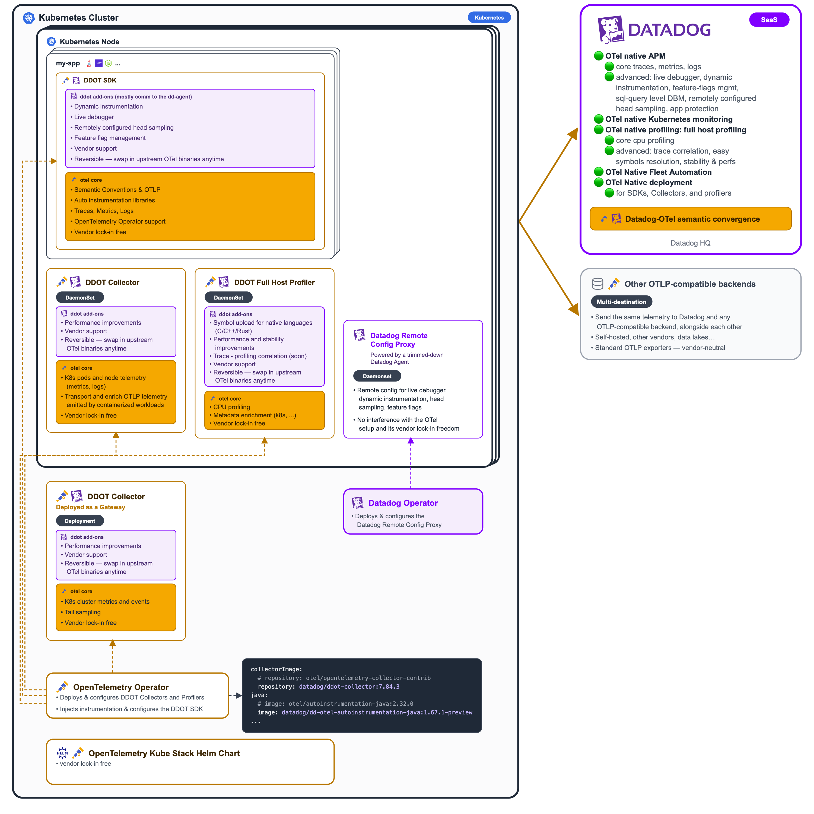

# Datadog installer for DDOT on Kubernetes, with the OpenTelemetry Kube Stack Helm chart

The Datadog installer deploys the DDOT components on Kubernetes, using the [OpenTelemetry Kube Stack][chart] Helm chart.
This folder holds the installer (see the [installation guide](INSTALL.md)) and its configuration, including the
reference `values.yaml` for the chart, configured to send Kubernetes and application telemetry to Datadog.

## What this deploys



The `opentelemetry-kube-stack` chart installs the OpenTelemetry Operator and renders one `OpenTelemetryCollector` CR for
each entry under `collectors:`. This values file configures two of them:

- **`cluster`** — a single-replica Deployment responsible for cluster-scope telemetry: scraping kube-state-metrics and
  watching Kubernetes objects.
- **`daemon`** — a DaemonSet running on every node, responsible for node-scope telemetry (host and kubelet metrics) and
  for terminating the OTLP endpoint that application workloads send traces, logs, and metrics to.

The OpenTelemetry Operator also deploys an **`Instrumentation`** custom resource (`instrumentation:` in `values.yaml`):
an instrumentation configuration that instruments annotated Kubernetes workloads with the **DDOT SDKs**, Datadog's
version of the OpenTelemetry APM SDKs, and points them at the `daemon` collector's OTLP endpoint.

Optionally, the release installs the **host profiler** collector - a DaemonSet running the OpenTelemetry eBPF profiler
on every node and exporting profiles to Datadog. See [Host profiler (optional)](#host-profiler-optional).

The Datadog Agent itself is installed separately, via the **[Datadog Operator][dd-operator]** (`DatadogAgent` custom
resource, `datadog-agent.yaml`), running as a DaemonSet in its own **`datadog` namespace** — the namespace name used
throughout Datadog's own documentation and examples. The Datadog Operator and Agent are installed only for the Datadog
Agent to act as an **enabler of the DDOT SDKs**: the Agent enables the Datadog-specific features of the DDOT SDKs, such
as Live Debugger, Dynamic Instrumentation, Remote Configuration of head sampling, or Feature Flag Management. It is
deliberately scoped down (cluster checks, orchestrator explorer, KSM core, process collection, log collection, and APM
auto-instrumentation are all disabled): the OTel collectors above already handle Kubernetes object/metrics monitoring
and log collection, and application SDKs are instrumented via the OpenTelemetry Operator instead of Datadog single-step
APM instrumentation. The Datadog Cluster Agent is kept, as the node Agent relies on it for cluster-level metadata.
Dynamic Instrumentation, which Live Debugger is built on, stays enabled, including the system-probe module needed for Go
apps (Linux kernel >= 5.17, see [Live Debugger for Go][dd-live-debugger-go]).

## Quickstart

Download and run the `install` script, the recommended way to install. You don't need to clone the repository: by
default, the script downloads its configuration files (`values.yaml`, `datadog-agent.yaml`...) from GitHub:

```sh
curl -fsSL -o install https://raw.githubusercontent.com/DataDog/opentelemetry-examples/3644f115f8d41a6efa546312365104abd10e2a18/guides/kubernetes/configuration/opentelemetry-kube-stack/install
chmod +x install
./install
```

See the [installation guide](INSTALL.md) for the prerequisites, the script's prompts and options, verification, and
troubleshooting, and to [install without the `install` script](INSTALL.md#install-without-the-install-script).
To export to another observability backend in addition to Datadog, or to modify the configuration files, see
[Customize the installation](INSTALL.md#customize-the-installation).

Already running an OpenTelemetry Collector, the OpenTelemetry Operator, OpenTelemetry SDKs, or a Datadog Agent? See
[Adapt an existing configuration for DDOT](ADAPT-EXISTING-CONFIG.md) to adapt them instead of reinstalling. The guide
is written so that coding agents can follow it too.

### Instrument Kubernetes workloads with DDOT SDKs

Add one of the following annotations to the pod spec. To prevent double instrumentation by the OpenTelemetry Operator
and the Datadog Operator, also add the `admission.datadoghq.com/enabled: "false"` label alongside either annotation: it
prevents the Datadog Agent's admission controller from instrumenting the pod too.

- **Auto-instrument and auto-configure applications:** Add this annotation to a pod spec to inject a DDOT SDK and its
  automatic configuration. Replace `<language>` with `dotnet`, `java`, `nodejs`, `python`:

  ```yaml
  metadata:
    annotations:
      instrumentation.opentelemetry.io/inject-<language>: opentelemetry-operator-system/opentelemetry-kube-stack
    labels:
      admission.datadoghq.com/enabled: "false"
  ```

- **Manually instrument and auto-configure applications:** Bundle the DDOT SDK in the application container, then add
  this annotation for automatic configuration through environment-variable injection:

  ```yaml
  metadata:
    annotations:
      instrumentation.opentelemetry.io/inject-sdk: opentelemetry-operator-system/opentelemetry-kube-stack
    labels:
      admission.datadoghq.com/enabled: "false"
  ```

Datadog engineers upgrading a Kubernetes cluster set up with an earlier version of this guide: see the
[upgrade guide](UPGRADE.md).

### Hybrid OTel + Datadog APM instrumentation

`datadog-agent.yaml` ships with `features.apm.instrumentation.enabled: false`, since this guide instruments applications
via the OpenTelemetry Operator instead. It can be flipped to `true` to let the Datadog Agent auto-instrument workloads
too (e.g. while migrating a service from Datadog tracers to OTel SDKs) — but a pod must never be instrumented by both at
once.

The OpenTelemetry Operator marks a pod for injection with `instrumentation.opentelemetry.io/inject-*` pod
**annotations**. Datadog's admission controller cannot select on annotations:
`apm.instrumentation.targets[].podSelector` is a plain Kubernetes label selector, and only ever matches pod **labels**.
So to exclude an OTel-instrumented pod template from Datadog auto-instrumentation, add this label to it directly,
alongside the OTel annotations:

```yaml
metadata:
  labels:
    admission.datadoghq.com/enabled: "false"
```

That label makes Datadog's admission controller skip the pod outright — no `podSelector` needed.

## Host profiler (optional)

The host profiler runs the [Datadog host profiler][dd-host-profiler] (Datadog's own distribution of
the [OpenTelemetry eBPF profiler][ebpf-profiler], to which it actively contributes) as a collector DaemonSet on every
node and exports profiles to Datadog's OTLP intake.

Enable it by answering `y` to the installer's prompt, or install manually following
the [manual installation steps][dd-host-profiler-install]. Unlike the other collectors, its pods need more privileges,
which is why it is opt-in.

## Kubernetes cluster name detection

For EKS, AKS, and GKE, the installer enables the corresponding resource-detection preset in both collectors. The
OpenTelemetry Collector then automatically populates `k8s.cluster.name`.

For other Kubernetes platforms, the installer sets `resourceAttributes.k8s.cluster.name` to the supplied Kubernetes
cluster name.

### Kubernetes cluster name constraints

The supplied Kubernetes cluster name is used both as the OpenTelemetry `k8s.cluster.name` resource attribute and as the
Datadog Agent's `clusterName`, so it must satisfy the [Datadog Agent's restrictions][dd-cluster-name]. It's made of
dot-separated tokens that:

- only contain lowercase letters, numbers, and hyphens (`-`): no uppercase letters and no underscores (`_`);
- start with a letter;
- end with a letter or a number.

The whole name must be at most 80 characters long. For example, `my-k8s-cluster` and `prod.eu-west-1` are valid;
`my_k8s_cluster`, `My-k8s-cluster`, and `1-cluster` are not.

The Datadog Agent rewrites `_` to `-` and ignores names containing uppercase letters, so an invalid name leaves the
Agent's and the OpenTelemetry Collector's telemetry with different (or missing) Kubernetes cluster names. The installer
lowercases the supplied name and replaces `_` with `-` (with a message if it does); when installing manually, choose a
valid name and use it for both `k8s.cluster.name` and `K8S_CLUSTER_NAME`.

See `examples/` for rendered values and manifests for each deployment type. Regenerate them with
`make generate-otel-kube-stack-examples`.

The Datadog Agent is installed as its own step, via the Datadog Operator's `DatadogAgent` custom resource
(`datadog-agent.yaml`), in the `datadog` namespace — see [What this deploys](#what-this-deploys) and
[Install without the `install` script](INSTALL.md#install-without-the-install-script). See `examples-datadog-agent/`
for the manifests the Datadog Operator generates from it, rendered offline with the [datadog-operator][dd-operator]'s
`operator-render` CLI (built on the fly from a shallow clone under `tmp/`). Regenerate it with `make generate-datadog-operator-examples`.

Run `make generate-examples` to regenerate both sets of examples in one step.

## Resource allocation

Both collectors default to `500m` CPU / `1Gi` memory limits and `200m` CPU / `500Mi` memory requests. Scale up for large
Kubernetes clusters.

## Chart version

Verified against:

- `opentelemetry-kube-stack` chart `>= 0.24.2`
- Collector image `otel/opentelemetry-collector-contrib >= 0.161.0` (pinned in values.yaml under
  `opentelemetry-operator.manager.collectorImage`)

For operator metrics troubleshooting, see [TROUBLESHOOTING.md](TROUBLESHOOTING.md).

[chart]: https://github.com/open-telemetry/opentelemetry-helm-charts/tree/main/charts/opentelemetry-kube-stack
[dd-operator]: https://github.com/DataDog/datadog-operator
[dd-live-debugger-go]: https://docs.datadoghq.com/tracing/live_debugger/?prog_lang=go
[dd-cluster-name]: https://docs.datadoghq.com/containers/kubernetes/installation/

[ebpf-profiler]: https://github.com/open-telemetry/opentelemetry-ebpf-profiler
[dd-host-profiler]: https://github.com/DataDog/datadog-agent/tree/main/cmd/host-profiler
[dd-host-profiler-install]: INSTALL.md#install-without-the-install-script
