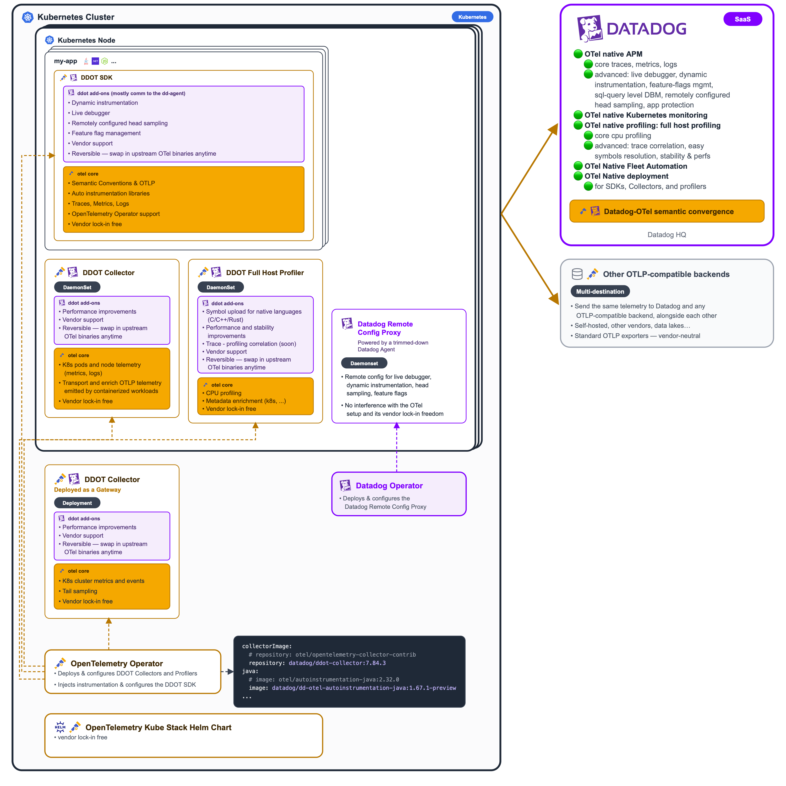

# Installation guide

The `install` script, the recommended way to install, sets up OpenTelemetry-based Kubernetes and application
monitoring for Datadog in one go. It installs:

- the [OpenTelemetry Kube Stack][chart]: the OpenTelemetry Operator, the `cluster` and `daemon` collectors, and the
  optional host profiler, which collect the Kubernetes and application telemetry. The OpenTelemetry Operator also
  deploys an `Instrumentation` custom resource, an instrumentation configuration that instruments annotated
  Kubernetes workloads with the DDOT SDKs, Datadog's version of the OpenTelemetry APM SDKs;
- [cert-manager][cm], if not already installed, for the OpenTelemetry Operator's admission webhook;
- the [Datadog Operator][dd-operator] and a Datadog Agent, installed only so that the Datadog Agent acts as an enabler
  of the DDOT SDKs: the Agent enables the Datadog-specific features of the DDOT SDKs, such as Live Debugger, Dynamic
  Instrumentation, Remote Configuration of head sampling, or Feature Flag Management, on top of the standard
  OpenTelemetry capabilities. The Datadog Agent neither collects the Kubernetes telemetry nor instruments the
  applications: the OpenTelemetry collectors and the OpenTelemetry Operator do.



See [What this deploys](README.md#what-this-deploys) for the architecture, and
[Install without the `install` script](#install-without-the-install-script) to perform the same installation manually
(not recommended).

Already running an OpenTelemetry Collector, the OpenTelemetry Operator, OpenTelemetry SDKs, or a Datadog Agent? See
[Adapt an existing setup to DDOT](ADAPT-EXISTING-CONFIG.md) to adapt them instead of reinstalling.

Contents:

- [Before you begin](#before-you-begin)
- [1. Download the script](#1-download-the-script)
- [2. Configure the installation](#2-configure-the-installation)
- [3. Run the script](#3-run-the-script)
- [4. Verify the installation](#4-verify-the-installation)
  - [Verify on the Kubernetes cluster](#verify-on-the-kubernetes-cluster)
  - [Verify in Datadog](#verify-in-datadog)
- [5. Instrument your applications](#5-instrument-your-applications)
  - [Go applications](#go-applications)
- [Options of the `install` script](#options-of-the-install-script)
- [Customize the installation](#customize-the-installation)
  - [Use an overlay values file for the OpenTelemetry Kube Stack Helm chart](#use-an-overlay-values-file-for-the-opentelemetry-kube-stack-helm-chart)
  - [Copy the configuration files locally](#copy-the-configuration-files-locally)
- [Upgrade an installation of the deprecated `ddot/install` script](#upgrade-an-installation-of-the-deprecated-ddotinstall-script)
- [Changes to the Kubernetes cluster](#changes-to-the-kubernetes-cluster)
- [Troubleshooting](#troubleshooting)
- [Uninstalling](#uninstalling)
- [Install without the `install` script](#install-without-the-install-script)

## Before you begin

On the machine running the script:

- **Bash** 3.2 or later, on Linux or macOS (the stock `/bin/bash` 3.2 on macOS works).
- **`kubectl`**, with its current context pointing at the target Kubernetes cluster (`kubectl config current-context`),
  and permissions to create namespaces, CRDs, cluster roles, and webhooks (typically `cluster-admin`).
- **`helm`**, v3 or v4.
- **`curl`**, to download the script and its configuration files.

From Datadog:

- A Datadog [API key][dd-api-keys] and your [Datadog site][dd-site] (`datadoghq.com`, `datadoghq.eu`,
  `us3.datadoghq.com`...).

On the Kubernetes cluster:

- Linux nodes with kernel >= 5.10 and Kubernetes >= 1.30, only if you enable the optional eBPF host profiler.
- On platforms other than EKS, GKE, and AKS, a Kubernetes cluster name that follows the
  [Kubernetes cluster name constraints](README.md#kubernetes-cluster-name-constraints) (lowercase letters, digits, `-`
  and `.`).

## 1. Download the script

The installer is the [`install` script of the parent folder](../install), which installs either the DDOT
components or upstream OpenTelemetry. You don't need to clone the repository: by default, the script downloads its
configuration files (`ddot/values.yaml`, `ddot/datadog-agent.yaml`...) from GitHub.

```sh
curl -fsSL -o install https://raw.githubusercontent.com/DataDog/opentelemetry-examples/v0.1.0/guides/kubernetes/configuration/opentelemetry-kube-stack/install
chmod +x install
```

> [!NOTE]
> The `ddot/install` script is deprecated. It runs the parent folder's `install` script with `DD_INSTALL_FLOW=ddot`.
> See [Upgrade an installation of the deprecated `ddot/install` script](#upgrade-an-installation-of-the-deprecated-ddotinstall-script).

## 2. Configure the installation

The script reads its configuration from environment variables only. It doesn't prompt for anything, so it can run
unattended, for example in CI. The variables, their defaults, and how a re-run reuses the values of the previous run are documented in
[Quickstart](../README.md#quickstart) in the parent folder's README. Set `DD_INSTALL_FLOW=ddot` to install the
DDOT components. On
platforms other than EKS, GKE, and AKS, set `K8S_CLUSTER_NAME`, following the
[Kubernetes cluster name constraints](README.md#kubernetes-cluster-name-constraints).

The script validates them before making any change.

```sh
export DD_INSTALL_FLOW=ddot
export DD_API_KEY="<your-datadog-api-key>"
export DD_SITE="datadoghq.com"
export K8S_CLUSTER_TYPE=eks
```

Alternatively, keep the configuration in a `.env` file, starting from
[`.env.example`](../.env.example) with `DD_INSTALL_FLOW=ddot`, and load it before running the script:

```sh
curl -fsSL -o .env https://raw.githubusercontent.com/DataDog/opentelemetry-examples/v0.1.0/guides/kubernetes/configuration/opentelemetry-kube-stack/.env.example
chmod 600 .env
# Edit .env, and set DD_INSTALL_FLOW=ddot
source .env
```

Keep `.env` out of version control (the repository's `.gitignore` ignores it).

## 3. Run the script

```sh
./install
```

It then:

- saves the installation options in the `opentelemetry-kube-stack-install-options` ConfigMap, for the next run;
- creates the `opentelemetry-operator-system` and `datadog` namespaces, and the `datadog-secret` secret in both;
- installs cert-manager, unless it's already installed;
- installs or upgrades the Datadog Operator in the `datadog` namespace;
- applies the `datadog-agent.yaml` `DatadogAgent` custom resource to the `datadog` namespace, substituting the
  Kubernetes cluster name, the site, and the `env` tag into it;
- installs or upgrades the OpenTelemetry Kube Stack Helm chart, optionally enabling the `host-profiler` collector in the
  same release. This is the last step, so that the chart's output, at the end of the script's output, is easy to read.

Some `WARNING` lines are expected and harmless, for example when a namespace already exists.

See [Changes to the Kubernetes cluster](#changes-to-the-kubernetes-cluster) for the exact `kubectl` and `helm` commands.

## 4. Verify the installation

### Verify on the Kubernetes cluster

Check that the collectors, the OpenTelemetry Operator, and the Datadog Operator and Agent are running:

```sh
kubectl get pods --namespace opentelemetry-operator-system
kubectl get pods --namespace datadog
kubectl get opentelemetrycollectors --namespace opentelemetry-operator-system
kubectl get datadogagent --namespace datadog
```

Expect a `cluster` OpenTelemetry Collector pod, one `daemon` OpenTelemetry Collector pod per node (plus one 
`host-profiler` pod per node when enabled), and one Datadog Agent pod per node next to the Datadog Operator and Cluster
Agent.

### Verify in Datadog

After a few minutes, the installation shows up in Datadog, under the Kubernetes cluster name you entered (or the one
detected on EKS, GKE, and AKS):

- **[Fleet Automation][dd-fleet-automation]** lists the Datadog Agents, and the `cluster` and `daemon` OpenTelemetry
  Collectors, which report to it through their [Datadog extension][dd-otel-extension]. Filter for the OpenTelemetry
  Collector hosts with the Collector facets, and check that each node runs one Datadog Agent and one `daemon`
  OpenTelemetry Collector, plus one `cluster` OpenTelemetry Collector. Click a host to see the OpenTelemetry
  Collector's version and build information in the **Info** tab, and its configuration, as YAML or as a pipeline
  visualization, in the **Configurations** tab.
- **The default OpenTelemetry Collector dashboard** (in **Dashboards**, search for `OpenTelemetry Collector`) shows
  the [health metrics][dd-otel-collector-health] that the OpenTelemetry Collectors export to Datadog through their own
  pipelines: accepted, refused, and sent telemetry, queue sizes, and resource usage. Check that the OpenTelemetry
  Collectors receive and export telemetry without refused or failed data.
- The Kubernetes cluster also shows up in Datadog's Kubernetes views.

## 5. Instrument your applications

The OpenTelemetry Operator deploys an `Instrumentation` Kubernetes custom resource,
`opentelemetry-operator-system/opentelemetry-kube-stack`: an instrumentation configuration that instruments annotated
pods with the DDOT SDKs, Datadog's version of the OpenTelemetry APM SDKs, and points them at the `daemon`
collector. The Datadog Agent enables the DDOT SDKs' Datadog-specific features, such as Live Debugger, Dynamic
Instrumentation, Remote Configuration of head sampling, or Feature Flag Management. Add the annotation for your application's language to its pod template, along
with the `admission.datadoghq.com/enabled` label, for example for Java:

```yaml
spec:
  template:
    metadata:
      annotations:
        instrumentation.opentelemetry.io/inject-java: opentelemetry-operator-system/opentelemetry-kube-stack
        resource.opentelemetry.io/service.name: my-service
      labels:
        # Prevent dual instrumentation by the Datadog Operator and the OpenTelemetry Operator.
        admission.datadoghq.com/enabled: "false" # Label values are strings: keep the quotes.
```

The other languages use `inject-nodejs`, `inject-python`, and `inject-dotnet`.

The `admission.datadoghq.com/enabled: "false"` label makes Datadog's admission controller skip the pod,
so that the pod is never instrumented by both the Datadog Operator and the OpenTelemetry Operator. The Datadog
Operator's APM instrumentation is disabled by default (`features.apm.instrumentation.enabled: false` in
`datadog-agent.yaml`): the label protects your pods if this configuration is later changed, for example to
auto-instrument other workloads with Datadog's single-step APM instrumentation. See
[Hybrid OTel + Datadog APM instrumentation](README.md#hybrid-otel--datadog-apm-instrumentation).

### Go applications

Go is compiled to native code, so it can't be auto-instrumented at runtime by injecting an agent the way Java or
Node.js can. The best practice is **compile-time auto-instrumentation**: it instruments Go apps the same way as apps in
other languages. Popular frameworks and libraries (`net/http`, gRPC, database drivers...) are auto-instrumented, and
the application code uses only the OpenTelemetry APIs to enrich the auto-instrumentation, with custom spans,
attributes, or metrics. It doesn't use the OpenTelemetry SDKs directly.

Instrument at build time with the tool that matches your SDK:

- **Upstream OpenTelemetry SDK for Go:** [OpenTelemetry Go compile-time instrumentation][otel-go-compile-time].
- **DDOT SDK for Go**, the Datadog OpenTelemetry SDK for Go: [Orchestrion][orchestrion].

Then add the `inject-sdk` annotation to the pod template. The OpenTelemetry Operator doesn't inject any SDK for this
annotation: it only injects the OpenTelemetry configuration (`OTEL_*` environment variables, such as the `daemon`
collector's endpoint and the resource attributes):

```yaml
spec:
  template:
    metadata:
      annotations:
        instrumentation.opentelemetry.io/inject-sdk: opentelemetry-operator-system/opentelemetry-kube-stack
        resource.opentelemetry.io/service.name: my-service
      labels:
        # Prevent dual instrumentation by the Datadog Operator and the OpenTelemetry Operator.
        admission.datadoghq.com/enabled: "false" # Label values are strings: keep the quotes.
```

## Options of the `install` script

The `install` script accepts one optional argument: a local values file merged on top of the `ddot/values.yaml` file of
the OpenTelemetry Kube Stack Helm chart. See
[Use an overlay values file](#use-an-overlay-values-file-for-the-opentelemetry-kube-stack-helm-chart).

## Customize the installation

The `install` script installs a configuration that sends Kubernetes and application telemetry to Datadog. Customize it
in one of two ways:

- [**An overlay values file**](#use-an-overlay-values-file-for-the-opentelemetry-kube-stack-helm-chart) for the
  OpenTelemetry Kube Stack Helm chart. Use it for targeted changes to the collectors, such as exporting to another
  observability backend. You keep receiving the updates to the reference `values.yaml`.
- [**Local copies of the configuration files**](#copy-the-configuration-files-locally). It gives full control, including over the `DatadogAgent` custom resource (`datadog-agent.yaml`),
  but you have to maintain your copies yourself.

### Use an overlay values file for the OpenTelemetry Kube Stack Helm chart

The script passes the overlay values file to the `helm upgrade --install opentelemetry-kube-stack ...` command after
the reference `values.yaml`, so its values take precedence. The overlay values file must be a local file.

For example, to export the traces of the `daemon` collector to a [Jaeger][jaeger] instance in addition to Datadog,
use [`examples/export-to-datadog-and-jaeger/values.yaml`](examples/export-to-datadog-and-jaeger/values.yaml):

```yaml
collectors:
  daemon:
    config:
      exporters:
        otlp/jaeger:
          endpoint: jaeger.jaeger.svc.cluster.local:4317
          tls:
            insecure: true

      service:
        pipelines:
          traces:
            exporters: [datadog/connector, otlp/jaeger]
```

Download it, or write your own, then pass it to the script:

```sh
curl -fsSL -o jaeger-values.yaml https://raw.githubusercontent.com/DataDog/opentelemetry-examples/v0.1.0/guides/kubernetes/configuration/opentelemetry-kube-stack/ddot/examples/export-to-datadog-and-jaeger/values.yaml
./install jaeger-values.yaml
```

- Helm merges maps but **replaces lists**: the overlay's `exporters` list replaces the one of the reference
  `values.yaml`, so it must repeat `datadog/connector`, or the traces stop flowing to Datadog. Check the current lists in
  `values.yaml` (`collectors.daemon.config.service.pipelines`) before overriding one.
- Adapt the endpoint and the TLS settings to your Jaeger instance: this example expects the OTLP gRPC endpoint of a
  Jaeger instance in the `jaeger` namespace, without TLS.
- The same pattern applies to any OTLP-compatible observability backend, and to the `logs` and `metrics` pipelines.

### Copy the configuration files locally

The `install` script reads its configuration files from the base URL in the `TESTING_BASE_URL` environment variable
when it's set, including a `file://` URL. Download the script and its configuration files, from the same tag, keeping
their folder layout:

```sh
CONFIG_RAW_URL=https://raw.githubusercontent.com/DataDog/opentelemetry-examples/v0.1.0/guides/kubernetes/configuration/opentelemetry-kube-stack
for file in install upstream/values.yaml ddot/values.yaml ddot/datadog-agent.yaml \
    ddot/host-profiler-rbac-values.yaml ddot/host-profiler-network-policy.yaml \
    ddot/host-profiler-cilium-network-policy.yaml; do
  curl -fsSL --create-dirs -o "$file" "$CONFIG_RAW_URL/$file"
done
chmod +x install
```

Modify the local files, mainly:

- `ddot/values.yaml`, the values file of the OpenTelemetry Kube Stack Helm chart: the collectors, their pipelines and
  resources, the `Instrumentation` custom resource...
- `ddot/datadog-agent.yaml`, the `DatadogAgent` custom resource from which the Datadog Operator deploys the Datadog Agent: its
  features, resources...

Then run the script from that folder, with `TESTING_BASE_URL` pointing at it, and optionally with an overlay values file:

```sh
DD_INSTALL_FLOW=ddot TESTING_BASE_URL="file://$PWD" ./install
# or
DD_INSTALL_FLOW=ddot TESTING_BASE_URL="file://$PWD" ./install my-overlay-values.yaml
```

- Keep the `opentelemetry-operator-system` and `datadog` namespaces: the script and the DDOT SDK instrumentation
  annotations rely on them.
- Your local copies don't receive the fixes and updates of this guide: compare them with the newer versions when you
  upgrade.

## Changes to the Kubernetes cluster

The `install` script modifies the Kubernetes cluster with the following commands, in this order. All of them create or
update resources: the script never deletes anything from the Kubernetes cluster, so re-running it is safe. Every
resource and Helm release gets the `install.datadoghq.com/installed-by=datadog-otel-onboarding-script` label and
`install.datadoghq.com/*` provenance annotations. See [Chart version](../README.md#chart-version) for the version of
the OpenTelemetry Kube Stack Helm chart, and the parent folder's [`install`](../install) script for the other versions.

| #  | Command                                                                                                                         | When                                                                                                                       | Effect                                                                                                                                                                        |
|:---|:--------------------------------------------------------------------------------------------------------------------------------|:---------------------------------------------------------------------------------------------------------------------------|:------------------------------------------------------------------------------------------------------------------------------------------------------------------------------|
| 1  | `kubectl create namespace opentelemetry-operator-system`                                                                        | Always (warns and continues on failure)                                                                                     | Creates the namespace of the OpenTelemetry Kube Stack.                                                                                                                        |
| 2  | `kubectl apply` of the `opentelemetry-kube-stack-install-options` ConfigMap                                                     | Always                                                                                                                     | Saves the installation options, which the next run reuses.                                                                                                                    |
| 3  | `kubectl apply` of the `datadog-secret` secret in `opentelemetry-operator-system`                                               | Always                                                                                                                     | Creates or updates the secret with `api-key` and `dd-site`, which the OpenTelemetry Collectors' Datadog exporter reads.                                                       |
| 4  | `helm install cert-manager cert-manager --repo https://charts.jetstack.io --namespace cert-manager --create-namespace ...`       | Always (warns and continues on failure, for example when cert-manager is already installed)                                | Installs cert-manager and its CRDs in the `cert-manager` namespace.                                                                                                           |
| 5  | `kubectl apply` of `host-profiler-network-policy.yaml` or `host-profiler-cilium-network-policy.yaml`                            | Host Profiler is enabled and an [egress policy](../README.md#host-profiler-optional) is selected (warns and continues on failure) | Creates or updates the `opentelemetry-kube-stack-host-profiler-egress` policy in `opentelemetry-operator-system`. After a successful apply, updates the remembered policy kind in the install-options ConfigMap. |
| 6  | `kubectl create namespace datadog`                                                                                              | Always (warns and continues on failure)                                                                                     | Creates the namespace of the Datadog Operator and Agent.                                                                                                                      |
| 7  | `kubectl apply` of the `datadog-secret` secret in `datadog`                                                                     | Always                                                                                                                     | Creates or updates the secret with `api-key`, and `app-key` when `DD_APP_KEY` is set.                                                                                         |
| 8  | `helm upgrade --install datadog-operator datadog-operator --repo https://helm.datadoghq.com --namespace datadog ...`             | Always                                                                                                                     | Installs or upgrades the Datadog Operator and its CRDs, with Fleet Automation when `DD_APP_KEY` is set.                                                                       |
| 9  | `kubectl apply --namespace datadog -f -` (`datadog-agent.yaml`, with the Kubernetes cluster name, site, and `env` tag substituted) | Always                                                                                                                  | Creates or updates the `DatadogAgent` custom resource, from which the Datadog Operator deploys the Datadog Agent DaemonSet and the Cluster Agent.                            |
| 10 | `helm upgrade --install opentelemetry-kube-stack opentelemetry-kube-stack --repo https://open-telemetry.github.io/opentelemetry-helm-charts --namespace opentelemetry-operator-system --wait ...` | Always | Installs or upgrades the OpenTelemetry Operator and its CRDs, the `cluster` and `daemon` collectors, and the `Instrumentation` custom resource, plus the `host-profiler` collector and its RBAC (`host-profiler-rbac-values.yaml`) when enabled. |

Before making any change, the script also runs read-only checks and stops on a conflict:

- `kubectl get crd` for an OpenTelemetry Operator or a Datadog Operator that the script didn't install.
- `kubectl auth can-i` for the permissions that the installation needs.
- `kubectl get` for an `opentelemetry-kube-stack-host-profiler-egress` NetworkPolicy or CiliumNetworkPolicy of a kind
  other than the selected one, left by a previous run: since both policies select the same pods and Kubernetes
  NetworkPolicies are additive, the script asks you to delete it rather than deleting it itself.

On the machine running the script, it downloads the configuration files to a temporary directory deleted on exit. It leaves your Helm repositories unchanged. When it exits, it sends [install telemetry](../README.md#install-telemetry)
to Datadog, unless `DD_INSTRUMENTATION_TELEMETRY_ENABLED=false`.

## Upgrade an installation of the deprecated `ddot/install` script

The deprecated `ddot/install` script didn't record its options, and the `install` script refuses to install over an
OpenTelemetry Operator or a Datadog Operator that it didn't install. Before you run the `install` script on a Kubernetes
cluster installed with `ddot/install`:

1. Remove the legacy `host-profiler` and `ddagent-kube-stack` Helm releases of earlier setups, if any:
   `helm uninstall <release> --namespace opentelemetry-operator-system --wait`. The `install` script doesn't check for
   them, and two eBPF profilers or two Datadog Agent DaemonSets must not run on the same node.
2. Record the `ddot` flow, so that the `install` script upgrades the installation:

   ```sh
   kubectl create configmap opentelemetry-kube-stack-install-options \
     --namespace opentelemetry-operator-system \
     --from-literal=DD_INSTALL_FLOW=ddot
   ```

The `ddot/install` script of the `main` branch does both, then runs the `install` script.

On `K8S_CLUSTER_TYPE=other`, `ddot/install` set the Kubernetes cluster name to `unknown-k8s-cluster` when
`K8S_CLUSTER_NAME` was unset. The `install` script leaves it unset: set `K8S_CLUSTER_NAME` to keep the same name.

## Troubleshooting

- **`Could not download ...`**: the configuration files couldn't be fetched from GitHub. Check the network access, or
  [use local copies of the configuration files](#copy-the-configuration-files-locally).
- **`A host-profiler egress ... from a previous installation conflicts with DD_HOST_PROFILER_NETWORK_POLICY=...`**: a previous run
  applied the other kind of host-profiler egress NetworkPolicy. Delete it with
  `kubectl delete <networkpolicy or ciliumnetworkpolicy> opentelemetry-kube-stack-host-profiler-egress --namespace opentelemetry-operator-system`,
  then re-run the script.
- **`Found an existing OpenTelemetry Operator installation`** or **`Found an existing Datadog Operator installation`**:
  the Kubernetes cluster already runs an operator that the script didn't install. If you installed it with the
  deprecated `ddot/install` script, see
  [Upgrade an installation of the deprecated `ddot/install` script](#upgrade-an-installation-of-the-deprecated-ddotinstall-script).
  Otherwise, remove it, or adapt the existing setup instead ([Adapt an existing setup to DDOT](ADAPT-EXISTING-CONFIG.md)).

## Uninstalling

The [`uninstall` script of the parent folder](../uninstall) removes everything the `install` script deployed. It's meant for development Kubernetes
clusters: it also uninstalls cert-manager and deletes the cert-manager, OpenTelemetry, and Datadog Operator CRDs, which
deletes all their custom resources cluster-wide, including ones the `install` script didn't create. It lists what it
deletes and asks for confirmation:

```sh
curl -fsSL -o uninstall https://raw.githubusercontent.com/DataDog/opentelemetry-examples/v0.1.0/guides/kubernetes/configuration/opentelemetry-kube-stack/uninstall
chmod +x uninstall
./uninstall
```

## Install without the `install` script

> [!IMPORTANT]
> The [`install` script](#1-download-the-script) is the strongly recommended way to install. Follow these manual steps
> only if you can't or don't want to use it, for example to integrate the installation into your own tooling, such as
> GitOps pipelines.

To perform the same installation without the `install` script, create a Kubernetes secret for the Datadog credentials,
install cert-manager, then apply a platform-specific values overlay. Run these commands from a clone of this repository,
in this folder: they use its `values.yaml`, `examples/`, and `datadog-agent.yaml` files.

Set the Datadog credentials:

```sh
export DD_API_KEY="<your-datadog-api-key>"
export DD_SITE="datadoghq.com" # Use your Datadog site when different.
```

Create the namespaces and the `datadog-secret` secret, duplicated into both — `opentelemetry-operator-system` for the
OTel collectors' Datadog exporter, `datadog` for the `DatadogAgent` custom resource. Two copies are needed because a
`DatadogAgent` custom resource can only reference a secret in its own namespace:

```sh
kubectl create namespace opentelemetry-operator-system \
  --dry-run=client -o yaml | kubectl apply -f -
kubectl create namespace datadog \
  --dry-run=client -o yaml | kubectl apply -f -

for NS in opentelemetry-operator-system datadog; do
  kubectl create secret generic datadog-secret \
    --namespace "$NS" \
    --from-literal="api-key=$DD_API_KEY" \
    --from-literal="dd-site=$DD_SITE" \
    --dry-run=client -o yaml | kubectl apply -f -
done
```

Install cert-manager:

```sh
helm repo add jetstack https://charts.jetstack.io
helm repo update
helm upgrade --install cert-manager jetstack/cert-manager \
  --namespace cert-manager \
  --create-namespace \
  --set crds.enabled=true \
  --wait \
  --timeout 5m
```

Create `deployment/values.yaml` by copying the example for the Kubernetes cluster platform, then set its deployment
environment. EKS, GKE, and AKS enable the appropriate resource detector and automatically determine `k8s.cluster.name`:

```sh
mkdir -p deployment

# Choose one:
cp examples/eks-deployment/values.yaml deployment/values.yaml
cp examples/gcp-deployment/values.yaml deployment/values.yaml
cp examples/aks-deployment/values.yaml deployment/values.yaml
```

For other Kubernetes platforms, start with the manual Kubernetes cluster name example and replace `my-k8s-cluster` and
`production` with the Kubernetes cluster name and deployment environment. `DD_SITE` continues to be sourced from
`datadog-secret`.

```sh
mkdir -p deployment
cp examples/manually-set-k8s-cluster-name/values.yaml deployment/values.yaml
```

The selected file is an overlay for this directory's base `values.yaml`; add any deployment-specific configuration to
`./deployment/values.yaml`. Install or upgrade the chart with both files:

```sh
helm repo add open-telemetry https://open-telemetry.github.io/opentelemetry-helm-charts
helm repo update
helm upgrade --install opentelemetry-kube-stack \
  open-telemetry/opentelemetry-kube-stack \
  --version 0.27.3 \
  --namespace opentelemetry-operator-system \
  --values ./values.yaml \
  --values ./deployment/values.yaml
```

Alternatively, if you want to enable the `host-profiler` collector:

```sh
helm upgrade --install opentelemetry-kube-stack \
  open-telemetry/opentelemetry-kube-stack \
  --version 0.27.3 \
  --namespace opentelemetry-operator-system \
  --set collectors.host-profiler.enabled=true \
  --values ./values.yaml \
  --values ./host-profiler-rbac-values.yaml \
  --values ./deployment/values.yaml
```

On Kubernetes clusters enforcing NetworkPolicy, also apply one of:

```sh
kubectl apply -f ./host-profiler-network-policy.yaml          # any enforcing CNI
# or
kubectl apply -f ./host-profiler-cilium-network-policy.yaml   # Cilium, FQDN-scoped egress
```

Finally, install the [Datadog Operator][dd-operator] and apply the `DatadogAgent` custom resource, setting the
Kubernetes cluster name and site in `datadog-agent.yaml`. Use the same
Kubernetes cluster name as `deployment/values.yaml` above, following the
[Kubernetes cluster name constraints](README.md#kubernetes-cluster-name-constraints) (leave `K8S_CLUSTER_NAME` empty on
EKS/GKE/AKS, where it's auto-detected instead):

```sh
export K8S_CLUSTER_NAME="my-k8s-cluster" # empty string on EKS/GKE/AKS

helm repo add datadog https://helm.datadoghq.com
helm repo update
OPERATOR_HELM_ARGS=(--set apiKeyExistingSecret=datadog-secret --set-string site="$DD_SITE")
if [[ -n "$K8S_CLUSTER_NAME" ]]; then
  OPERATOR_HELM_ARGS+=(--set-string clusterName="$K8S_CLUSTER_NAME")
fi
helm upgrade --install datadog-operator \
  datadog/datadog-operator \
  --version 2.33.0 \
  --namespace datadog \
  "${OPERATOR_HELM_ARGS[@]}" \
  --wait --timeout 5m

# On EKS/GKE/AKS (empty K8S_CLUSTER_NAME), leave clusterName unset so the Agent auto-detects it.
GLOBAL_JSON="\"site\":\"$DD_SITE\""
if [[ -n "$K8S_CLUSTER_NAME" ]]; then
  GLOBAL_JSON+=",\"clusterName\":\"$K8S_CLUSTER_NAME\""
fi

kubectl patch --local \
  -f ./datadog-agent.yaml \
  --type merge \
  -p "{\"spec\":{\"global\":{$GLOBAL_JSON}}}" \
  -o yaml | kubectl apply --namespace datadog -f -
```

[chart]: https://github.com/open-telemetry/opentelemetry-helm-charts/tree/main/charts/opentelemetry-kube-stack
[cm]: https://cert-manager.io/docs/installation/
[dd-operator]: https://github.com/DataDog/datadog-operator
[dd-api-keys]: https://docs.datadoghq.com/account_management/api-app-keys/#api-keys
[dd-site]: https://docs.datadoghq.com/getting_started/site/
[jaeger]: https://www.jaegertracing.io/
[otel-go-compile-time]: https://opentelemetry.io/docs/zero-code/go/compile-time/
[orchestrion]: https://github.com/DataDog/orchestrion
[dd-fleet-automation]: https://docs.datadoghq.com/agent/fleet_automation/
[dd-otel-collector-health]: https://docs.datadoghq.com/opentelemetry/integrations/collector_health_metrics/
[dd-otel-extension]: https://docs.datadoghq.com/opentelemetry/integrations/datadog_extension/
