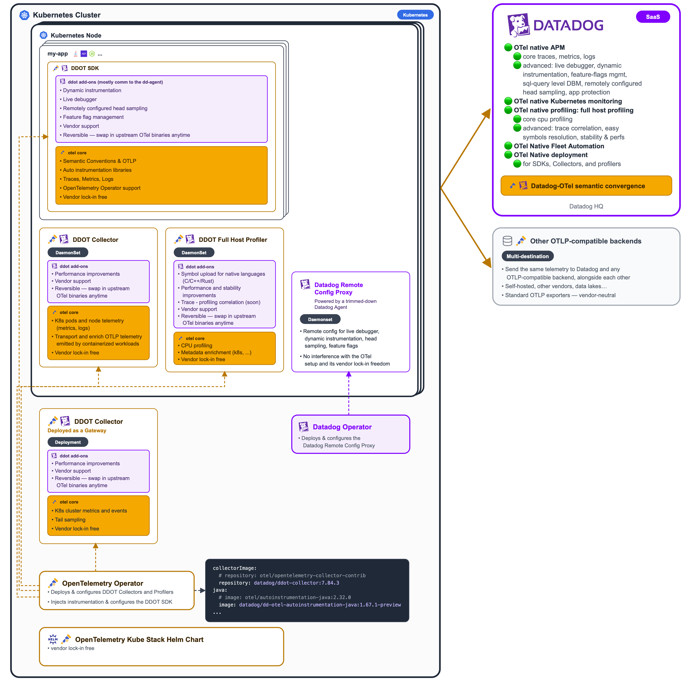

# Datadog installer for DDOT on Kubernetes, with the OpenTelemetry Kube Stack Helm chart

This directory contains the Datadog installer for DDOT and its configuration, including a reference `values.yaml` for the
[OpenTelemetry Kube Stack][chart] Helm chart that sends Kubernetes and application telemetry to Datadog. To install, see the [installation guide](INSTALL.md).

## What this deploys



The `opentelemetry-kube-stack` chart installs the OpenTelemetry Operator and renders one `OpenTelemetryCollector` CR for
each entry under `collectors:`. This values file configures two of them:

- **`cluster`**: a single-replica Deployment for cluster-scope telemetry. It scrapes kube-state-metrics and watches
  Kubernetes objects.
- **`daemon`**: a DaemonSet on every node for node-scope telemetry (host and kubelet metrics). It also serves the OTLP
  endpoint that application workloads send traces, logs, and metrics to.

The OpenTelemetry Operator also deploys an [`Instrumentation`][otel-auto-instrumentation] custom resource
(`instrumentation:` in `values.yaml`). It instruments annotated Kubernetes workloads with the **DDOT SDKs**, Datadog's
version of the OpenTelemetry APM SDKs, and points them at the `daemon` collector's OTLP endpoint.

You can also install the **host profiler** collector, a DaemonSet that runs the OpenTelemetry eBPF profiler on every
node and exports profiles to Datadog. See [Host profiler (optional)](#host-profiler-optional).

The [Datadog Operator][dd-operator] installs the Datadog Agent separately, from the `DatadogAgent` custom resource in
`datadog-agent.yaml`, as a DaemonSet in the `datadog` namespace. The Datadog Agent acts only as an **enabler of the DDOT
SDKs**: it enables their Datadog-specific features, such as Live Debugger, Dynamic Instrumentation, Remote Configuration
of head sampling, or Feature Flag Management.

The OpenTelemetry collectors handle Kubernetes object and metrics monitoring and log collection, and the OpenTelemetry
Operator instruments applications. The Agent configuration therefore disables cluster checks, orchestrator explorer, KSM
core, process collection, log collection, and APM auto-instrumentation (Datadog single-step APM instrumentation). It
keeps:

- the Datadog Cluster Agent, which the node Agent relies on for cluster-level metadata;
- Dynamic Instrumentation, which Live Debugger is built on, including the system-probe module that Go apps need (Linux
  kernel >= 5.17, see [Live Debugger for Go][dd-live-debugger-go]).

## Quickstart

Download and run the `install` script, the recommended way to install. You don't need to clone the repository: by
default, the script downloads its configuration files from GitHub. It reads its configuration from environment
variables:

```sh
curl -fsSL -o install https://raw.githubusercontent.com/DataDog/opentelemetry-examples/bddea96e59ce0cb8006068df17aa50839f1d439d/guides/kubernetes/configuration/opentelemetry-kube-stack/ddot/install
chmod +x install
export DD_API_KEY="<your-datadog-api-key>"
export DD_SITE="datadoghq.com"
export K8S_CLUSTER_TYPE=eks # eks, gcp, aks, or other
./install
```

See the [installation guide](INSTALL.md) for details, including how to
[install without the `install` script](INSTALL.md#install-without-the-install-script).
To export to another observability backend in addition to Datadog, or to change the configuration files, see
[Customize the installation](INSTALL.md#customize-the-installation).

If you already run an OpenTelemetry Collector, the OpenTelemetry Operator, OpenTelemetry SDKs, or a Datadog Agent, see
[Adapt an existing configuration for DDOT](ADAPT-EXISTING-CONFIG.md) instead of reinstalling. Coding
agents can also follow that guide.

### Instrument Kubernetes workloads with DDOT SDKs

See [Instrument your applications](INSTALL.md#5-instrument-your-applications).

### Hybrid OTel + Datadog APM instrumentation

`datadog-agent.yaml` sets `features.apm.instrumentation.enabled: false` because the OpenTelemetry Operator instruments
applications. Set it to `true` to let the Datadog Agent also auto-instrument workloads, for example while you migrate a
service from Datadog tracers to OpenTelemetry SDKs. A pod must never be instrumented by both at once.

To exclude an OpenTelemetry-instrumented pod template from Datadog auto-instrumentation, add this label to it:

```yaml
metadata:
  labels:
    admission.datadoghq.com/enabled: "false"
```

See [Use the Datadog Admission Controller][dd-ssi-k8s].

## Host profiler (optional)

The host profiler collector runs the [Datadog host profiler][dd-host-profiler], Datadog's distribution of the
[OpenTelemetry eBPF profiler][ebpf-profiler], as a DaemonSet on every node. It exports profiles to Datadog's OTLP intake.

Its pods need more privileges than the other collectors, so it is opt-in. To enable it, set
`DD_HOST_PROFILER_ENABLED=true` before you run the installer, or follow the
[manual installation steps][dd-host-profiler-install].

## Kubernetes cluster name detection

For EKS, AKS, and GKE, the installer enables the matching resource-detection preset in both collectors. The
OpenTelemetry Collector then sets `k8s.cluster.name` automatically.

For other Kubernetes platforms, the installer sets `resourceAttributes.k8s.cluster.name` to the Kubernetes cluster name
you supply.

### Kubernetes cluster name constraints

The Kubernetes cluster name you supply becomes both the OpenTelemetry `k8s.cluster.name` resource attribute and the
Datadog Agent's `clusterName`, so it must follow the [Datadog Agent's cluster name restrictions][dd-cluster-name].
For example, `my-k8s-cluster` and `prod.eu-west-1` are valid;
`my_k8s_cluster`, `My-k8s-cluster`, and `1-cluster` are not.

The Datadog Agent rewrites `_` to `-` and ignores names that contain uppercase letters. With an invalid name, the Agent's
and the OpenTelemetry Collector's telemetry end up with different or missing Kubernetes cluster names. When you install
manually, use the same name for both `k8s.cluster.name` and `K8S_CLUSTER_NAME`.

## Rendered examples

- `examples/` contains rendered values and manifests for each deployment type. Regenerate them with
  `make generate-otel-kube-stack-examples`.
- `examples-datadog-agent/` contains the manifests that the Datadog Operator generates from `datadog-agent.yaml`,
  rendered offline with the [datadog-operator][dd-operator]'s `operator-render` CLI. Regenerate them with
  `make generate-datadog-operator-examples`.

Run `make generate-examples` to regenerate both sets of examples in one step.

## Resource allocation

Both collectors default to `500m` CPU / `1Gi` memory limits and `200m` CPU / `500Mi` memory requests. Scale up for large
Kubernetes clusters.

## Chart version

Verified against:

- `opentelemetry-kube-stack` chart `>= 0.26.1`
- Collector image `otel/opentelemetry-collector-contrib >= 0.163.1` (pinned in values.yaml under
  `opentelemetry-operator.manager.collectorImage`)

## Troubleshooting

For OpenTelemetry Operator metrics troubleshooting, see [TROUBLESHOOTING.md](TROUBLESHOOTING.md).

[chart]: https://github.com/open-telemetry/opentelemetry-helm-charts/tree/main/charts/opentelemetry-kube-stack
[dd-operator]: https://github.com/DataDog/datadog-operator
[dd-live-debugger-go]: https://docs.datadoghq.com/tracing/live_debugger/?prog_lang=go
[dd-cluster-name]: https://docs.datadoghq.com/containers/kubernetes/installation/
[dd-ssi-k8s]: https://docs.datadoghq.com/tracing/trace_collection/automatic_instrumentation/single-step-apm/kubernetes/#use-the-datadog-admission-controller
[otel-auto-instrumentation]: https://opentelemetry.io/docs/platforms/kubernetes/operator/automatic/
[ebpf-profiler]: https://github.com/open-telemetry/opentelemetry-ebpf-profiler
[dd-host-profiler]: https://github.com/DataDog/datadog-agent/tree/main/cmd/host-profiler
[dd-host-profiler-install]: INSTALL.md#install-without-the-install-script
